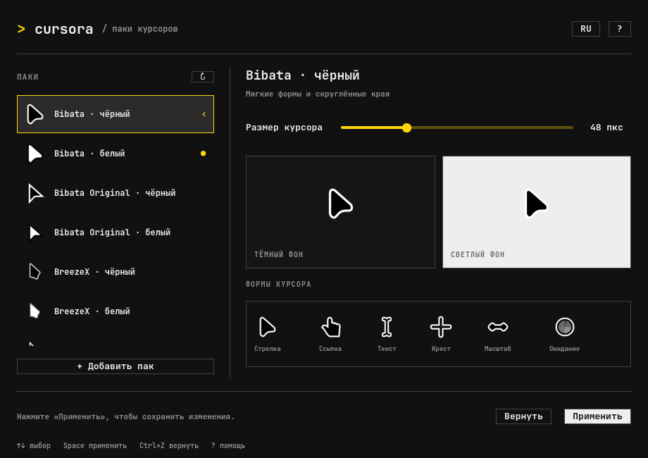

Cursora — выбор внешнего вида курсора для Omarchy с конфигурацией Hyprland на Lua.
Выберите пак слева, задайте размер и нажмите **Применить**. Предпросмотр на светлом и тёмном фоне обновляется при изменении размера.

В комплекте 11 монохромных вариантов шести семейств:

| Семейство | Формы | Варианты |
| --- | --- | --- |
| [Bibata Modern](https://github.com/ful1e5/Bibata_Cursor) | Мягкие, скруглённые | Чёрный и белый |
| [BreezeX](https://github.com/ful1e5/BreezeX_Cursor) | Острые, угловатые | Чёрный и белый |
| [Phinger](https://github.com/phisch/phinger-cursors) | Компактная стрелка, выразительные руки | Чёрный и белый |
| [Bibata Original](https://github.com/ful1e5/Bibata_Cursor) | Заострённая стрелка | Чёрный и белый |
| [DMZ](https://sources.debian.org/src/dmz-cursor-theme/0.4.5.2/) | Классическая стрелка | Чёрный и белый |
| [Banana](https://github.com/ful1e5/banana-cursor) | Изогнутый указатель | Монохромный |

Установленные системные и пользовательские темы тоже доступны в списке.
Размер можно задать от 16 до 128 пикселей. Приложения, которые используют растровый
Xcursor, могут выбрать ближайший доступный размер из пака. При смене только пака
Cursora использует текущий размер рабочего стола.

Окно следует цветам и радиусам углов текущей темы Omarchy: моноширинный шрифт,
тонкие границы и плоские элементы управления. Поддерживаются русский, английский
и датский; язык можно выбрать отдельно или следовать языку Omarchy.

### Запуск

**Super + Space → Cursora**, либо:

```sh
cursora open
```

Выбор сохраняется после перезагрузки. Некоторым уже запущенным приложениям может
понадобиться перезапуск. **Вернуть** восстанавливает настройки до последнего
применения и отказывается перезаписывать файлы с последующими ручными правками.

Для своего пака нажмите **Добавить пак → Открыть папку тем**, распакуйте туда папку
Xcursor-темы с вложенной `cursors` и обновите список (`Ctrl+R`). Для темы только
в формате Hyprcursor нужна совместимая версия Xcursor.

### Клавиши

| Клавиша | Действие |
| --- | --- |
| ↑ / ↓ в списке | Выбрать пак |
| ← / → на ползунке | Изменить размер |
| Space | Применить |
| Ctrl+Z | Вернуть предыдущие настройки |
| Ctrl+R | Обновить список |
| Esc | Сбросить неприменённый выбор |
| Q | Закрыть окно с подтверждением сброса неприменённого выбора |
| ? | Показать горячие клавиши |

### Командная строка

```sh
cursora list --json
cursora status --json
cursora apply --theme Cursora-Bibata-Black --size 48 --dry-run --json
cursora apply --theme Cursora-Bibata-Black --json
cursora undo --json
cursora skill install --json
```

`--dry-run` показывает план без записи. Коды завершения: 0 — успех, 1 — ошибка.
Ошибки также выводятся в stderr. Для применения нужен работающий сеанс Hyprland.
Параметр `--size` необязателен. `skill install` устанавливает инструкцию
для агентов в `~/.codex/skills/cursora/SKILL.md`.

### Сборка и проверка

```sh
./bin/build
./bin/test
./bin/install
```

Нужны Qt 6 Base, Declarative, Wayland, SVG, libXCursor, glib2, D-Bus, Hyprland,
adwaita-cursors, Python 3, qmake6, make и C++17-компилятор. Сборка работает без сети:
закреплённые архивы находятся в `vendor/`, проверяются по SHA-256 и безопасно
распаковываются без исполнения кода из архивов. Для сборки и установки используется
Arch-пакет.

Тесты проверяют применение и отмену размера, сохранение исходных настроек, защиту
ручных правок, обработку ошибок записи, смену цветов и языка, а также выбор и
применение через настоящее окно QML. `tests/check_packs.py` проверяет все
файлы курсоров и кадры анимаций: монохромность, размеры, прозрачность, точки нажатия
и длительность кадров относительно официальных архивов. Русское и датское окна
проверяются по снимкам; применение и возврат проверяются в Hyprland. Фактический курсор проверяется
по снимку экрана с указателем: его пиксели сравниваются с файлом выбранного пака,
а не только с названием темы в GSettings.

[Курсор до исправления](docs/cursor-before.png) · [После исправления](docs/cursor-after.png)

### Пользовательские настройки

Cursora добавляет `require("hypr.cursora")` в пользовательский `hyprland.lua` и
хранит свой модуль в `hypr/cursora.lua`. Также обновляются темы GTK 3/4, управляемые
блоки в `uwsm/env` и `uwsm/env-hyprland`, пользовательский `icons/default/index.theme`
и настройки самого приложения. Пути учитывают `XDG_CONFIG_HOME`, `XDG_DATA_HOME`
и `XDG_STATE_HOME`.

В работающей сессии обновляются GSettings, окружение новых приложений и курсор
Hyprland. Для совместимости с приложениями используется Xcursor. Исходные файлы
сохраняются в `~/.local/state/cursora/backups/`, записи выполняются атомарно;
при ошибке приложение пытается вернуть прежние настройки. Символические ссылки
конфигурации не заменяются. Пакетные файлы Omarchy не редактируются.

Код приложения — MIT. Bibata, Banana и BreezeX — GPL 3. Phinger — CC BY-SA 4.0, DMZ — CC BY-SA 3.0.
В каждой теме есть `COPYING` и `NOTICE`; исходники оригинальных паков и код
подготовки установлены в `/usr/share/cursora/sources`. Источники и контрольные
суммы перечислены в `vendor/sources.json`.
